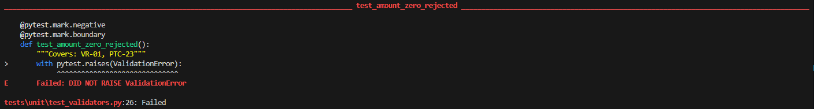
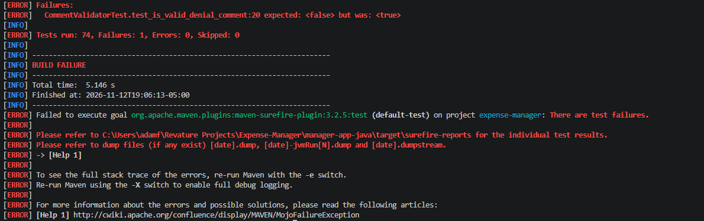

# Test Effectiveness Report

## 1. Python 

Date: 2026-11-22

Requirement: VR-01 - Expense amount must be greater than 0

Related Test Case: PTC-23

### Goal/Success Criteria
The goal of this test is to ensure that the expense amount entered by the user is validated correctly according to the requirement VR-01, which states that the amount must be greater than 0.

### The Temporary Bug
in `employee-app-python/employee_app/validators.py` at line 55, we changed:
```python
    if amount <= 0 or amount > 10000:
        raise ValidationError(AMOUNT_MSG)
```
To 
```python
    if amount < 0 or amount > 10000:
        raise ValidationError(AMOUNT_MSG)
```
This allowed the system to accept an expense amount of 0, which violates the requirement VR-01 that the amount must be greater than 0.

### Result
Our `test_amount_zero_rejected` unit test failed with `Failed: DID NOT RAISE ValidationError`. This indicates that our test correctly identified that the system did not raise a `ValidationError` for an expense amount of 0, which is a violation of the requirement VR-01.

### Evidence


## 2. Java

Date: 2026-11-22

Requirement: VR-05 - Denial comment must be 5-200 characters after trimming

Related Test Case: JTC-02

### Goal/Success Criteria
The goal of this test is to ensure that the denial comment entered by the user is validated correctly according to the requirement VR-05, which states that the comment must be between 5 and 200 characters after trimming.

### The Temporary Bug
in `manager-app-java/src/main/java/validation/CommentValidator.java` at line 10, we changed:
```java
        return len >= 5 && len <= 200;
```
To
```java
        return len >= 5 && len < 200;
```

### Result
Our `test_is_valid_denial_comment` unit test failed with `test_is_valid_denial_comment:20 expected: <false> but was: <true>`. This indicates that our test correctly identified that the system did not enforce the upper limit (inclusive) of 200 characters for denial comments as required by VR-05.

### Evidence
